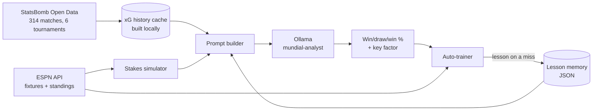

# ⚽ Mundial LLM — FIFA World Cup 2026 Match Predictor

[](https://github.com/BERgod27/WorldCup-LLM-2026/actions/workflows/tests.yml)

A local AI system that predicted FIFA World Cup 2026 matches by giving a locally running LLM real expected-goals (xG) history, live group standings, and a simulation of what each team needed from the game. The LLM runs on your own machine through [Ollama](https://ollama.com): no cloud model and no paid API. The only network calls are to public data sources, StatsBomb Open Data and ESPN.

It also learns from its mistakes: an auto-trainer replays each finished match, and when the prediction was wrong it asks the model to write a one-sentence lesson that is added to future prompts for those teams.

> **Status:** the 2026 World Cup finished in July 2026, so the live fixture menu has nothing left to list. You can still predict any pairing, and the backtest can score the model on the whole tournament (see [Usage](#usage)).

<!-- Add a screenshot of the fixture menu and a prediction here, e.g.  -->

---

## How it works



1. **Historical data.** On first run, [`cache_historical_data.py`](mundial_llm/cache_historical_data.py) downloads every match from six senior men's tournaments in [StatsBomb Open Data](https://github.com/statsbomb/open-data) (World Cup 2018 and 2022, Euro 2020 and 2024, Copa América 2024, AFCON 2023). It sums shot-level xG per team, leaving out penalty-shootout kicks, into a local 314-match cache covering 76 national teams. The download runs in parallel and retries; if any match fails, nothing is saved, so missing data is never stored as zero xG.
2. **Team context.** [`predict_match.py`](mundial_llm/predict_match.py) turns that cache into per-team context: W/D/L record, goals and xG for and against, recent form, a per-tournament breakdown, a match log, and head-to-head history.
3. **Stakes.** For an upcoming group game, [`match_stakes.py`](mundial_llm/match_stakes.py) fetches the live standings from ESPN. Before the last group game it enumerates every win/draw/loss combination of the group's remaining fixtures (3ⁿ scenarios) and classifies each team as *already qualified*, *eliminated*, *must win*, *a draw is enough*, or *standard*. It then turns that into an expected tactical attitude, for example that a must-win team presses high and leaves space behind.
4. **Inference.** Stats, standings, stakes and any relevant lessons go into a structured prompt for `mundial-analyst`, a custom Ollama model built from `qwen3.5:9b` (see [`model/`](model/)). The model answers with a fixed `PREDICTION:` block: win/draw/win percentages, the most likely scoreline and a one-line key tactical factor. The code parses that block into probabilities.
5. **Learning loop.** [`auto_trainer.py`](mundial_llm/auto_trainer.py) checks ESPN for newly finished matches and predicts each one blind: neutral stakes instead of the post-match standings, and only lessons learned from earlier matches. On a miss it asks the model to reflect, and stores the lesson with its match date in [`data/learning_memory.json`](data/learning_memory.json).

### Design decisions

- **Every fact comes from the prompt.** A 9B model's own memory of team strength is unreliable, so the stats it should use are retrieved and put in the prompt, and the prompt tells it to prioritise xG over reputation.
- **Local, small model.** The whole system has to run on an 8 GB consumer GPU (RTX 3060 Ti). `qwen3.5:9b` at 4-bit quantisation uses about 5–6 GB of VRAM, leaving room for a long context. Thinking mode is turned off for faster answers that keep to the output format.
- **Stakes come from simulation, not from the model.** Working out who qualifies under which results is arithmetic, which LLMs are bad at, so it is worked out in Python, by enumerating the remaining results, and handed to the model as text.
- **Lessons are memory, not fine-tuning.** Retraining weights after each match is impractical on this hardware. Storing short, dated lessons and retrieving them per team gives a cheap, inspectable form of learning that can still be backtested fairly.

---

## Results

[`evaluate_model.py`](mundial_llm/evaluate_model.py) replays past matches through the same prompt. Nothing in the prompt comes from the future: each match is predicted from matches played **before** it, the match date is hidden, and lessons (with `--with-lessons`) are limited to ones learned from earlier matches. Every run also scores a simple baseline on the same matches: the team with the better average xG differential wins.

Test set: every Euro 2024 and Copa América 2024 match (83 matches), predicted from the 2018–2023 tournaments plus earlier games in the same tournament.

| Predictor | Accuracy | Brier score ↓ |
|-----------|---------:|--------------:|
| Always 33/33/33 | — | 0.667 |
| xG differential baseline | 45.8% | — |
| `mundial-analyst` | _not run yet_ | _not run yet_ |
| `mundial-analyst` + lessons learned on 2018–2023 | _not run yet_ | _not run yet_ |

Reproduce with:

```powershell
python -m mundial_llm.evaluate_model --from-date 2024-06-01 --sample 0

# Lessons: empty data/learning_memory.json (set it to []), learn on the earlier
# tournaments only, then test with those lessons
python -m mundial_llm.evaluate_model --to-date 2024-06-01 --sample 0 --save-lessons
python -m mundial_llm.evaluate_model --from-date 2024-06-01 --sample 0 --with-lessons
```

**One caveat.** The prompt can't leak results, but the base model may remember famous 2024 results from its pretraining, because those tournaments happened before `qwen3.5` was released. The cleanest out-of-sample test is the 2026 World Cup, which the model has never seen: `python -m mundial_llm.evaluate_model --live-tournament`.

Draws are 27% of the matches in the dataset, and knockout games decided on penalties count as draws, so outcome accuracy in football is naturally low. The comparison against the baseline is what matters.

---

## Setup

### Requirements

- Python 3.11+ (CI tests 3.11 and 3.13)
- [Ollama](https://ollama.com)
- A GPU with about 6 GB of VRAM is recommended (tested on an RTX 3060 Ti 8 GB with 32 GB RAM). It also runs on CPU, slowly.

### 1. Install Ollama and build the model

```powershell
ollama pull qwen3.5:9b
ollama create mundial-analyst -f model/Modelfile
```

Ollama must be running in the background (`ollama serve`, or the desktop app) whenever you use the project. Check it with `python scripts/check_ollama.py`.

### 2. Python environment

```powershell
# Windows
python -m venv venv
.\venv\Scripts\Activate.ps1
pip install -r requirements.txt
```

```sh
# macOS / Linux
python3 -m venv venv
source venv/bin/activate
pip install -r requirements.txt
```

### 3. Historical data

The StatsBomb-derived cache isn't included in the repository (see [Data and credits](#data-and-credits)). It is built automatically the first time you run a prediction, which takes about 1–2 minutes and needs internet. You can also build it up front:

```powershell
python -m mundial_llm.cache_historical_data
```

---

## Usage

Run every command from the repository root, with the virtual environment active. Every command accepts `--model` to try another Ollama model.

### Live fixture menu

Lists the remaining 2026 World Cup games from ESPN and predicts the one you pick:

```powershell
python -m mundial_llm      # or double-click run.bat (Windows) / sh run.sh (macOS, Linux)
```

Use the number keys to pick a game, `N`/`P` to change page, `Q` to quit. Now that the tournament is over, it says so and suggests the commands below.

### Predict a specific match

```powershell
python -m mundial_llm.predict_match "Portugal" "France"
python -m mundial_llm.predict_match "Morocco" "Spain" --model llama3.1:8b
python -m mundial_llm.predict_match --list-teams
```

Team names are matched case-insensitively and fuzzily (`"portugall"` finds Portugal), and common ESPN spellings are mapped to StatsBomb's (`"Cape Verde"` finds Cape Verde Islands, `"USA"` finds United States). Teams with no history in the dataset are still predicted, with the stats sections marked N/A. A pairing that isn't an upcoming 2026 fixture gets neutral stakes.

### Learn from finished matches

```powershell
python -m mundial_llm.auto_trainer             # add --verbose to print each answer
```

This was built to run during the tournament. On a machine with no `data/trained_matches.json`, the first run only records the matches already finished, as a baseline, and later runs learn from new ones. The repository ships the files from my own run, so running it now processes every 2026 match not yet in that file. Delete `data/trained_matches.json` to start from a fresh baseline instead.

### Backtest

```powershell
python -m mundial_llm.evaluate_model --from-date 2024-06-01 --sample 0   # all matches since a date
python -m mundial_llm.evaluate_model --to-date 2024-06-01 --sample 0     # all matches before a date
python -m mundial_llm.evaluate_model --sample 50 --seed 42                # random sample, reproducible
python -m mundial_llm.evaluate_model --live-tournament                    # finished 2026 World Cup matches
```

Add `--save-lessons` to write a lesson for each miss, and `--with-lessons` to include lessons from earlier matches in the prompt.

### Chat with the analyst

```powershell
python -m mundial_llm.sports_analyst_cli
```

A general football-analysis chat with the base model, built with LangChain and conversation history. It doesn't load the project's data. Type `exit` to leave.

### Tests

```powershell
pytest
```

The tests cover the parts that need neither the LLM nor the network: parsing the model's percentages, team-name matching, team stats and form, shootout-free xG, the history and lesson date filters, the xG baseline, the Brier score, the stakes simulator and its fallbacks, and the menu's messages. They run on every push through GitHub Actions.

---

## Project structure

Each folder has its own README explaining what is inside.

```
├── mundial_llm/          The application code (Python package)       → mundial_llm/README.md
│   ├── mundial_menu.py       Live fixture menu + prediction
│   ├── predict_match.py      Team stats, prompt building, response parsing
│   ├── match_stakes.py       ESPN standings and the group-stage stakes simulator
│   ├── cache_historical_data.py  Builds the StatsBomb xG cache
│   ├── auto_trainer.py       Learns lessons from finished 2026 matches
│   ├── learning_memory.py    Stores and retrieves dated lessons
│   ├── evaluate_model.py     Backtesting with an xG baseline
│   ├── sports_analyst_cli.py Interactive chat mode
│   └── paths.py              Locations of the data files
├── data/                 Lesson memory, processed matches, local xG cache → data/README.md
├── model/                Modelfile for the mundial-analyst model       → model/README.md
├── scripts/              Setup checks for Ollama and StatsBomb         → scripts/README.md
├── tests/                pytest suite, run by GitHub Actions          → tests/README.md
├── docs/                 Original design notes                        → docs/README.md
├── run.bat / run.sh      One-click launchers
└── requirements.txt
```

Quick links: [code](mundial_llm/) · [data](data/) · [model](model/) · [tests](tests/) · [design notes](docs/)

---

## Tech stack

| Layer | Technology |
|-------|-----------|
| LLM runtime | [Ollama](https://ollama.com), `ollama` Python client |
| Model | `qwen3.5:9b` (4-bit), customised as `mundial-analyst` |
| Chat mode | LangChain (`langchain-ollama`) |
| Historical data | StatsBomb Open Data via `statsbombpy` |
| Live data | ESPN public endpoints via `requests` |
| Data processing | `pandas` |
| Testing / CI | `pytest`, GitHub Actions |

---

## Teams in the dataset

All 76 national teams that played in the six tournaments:

Albania, Algeria, Angola, Argentina, Australia, Austria, Belgium, Bolivia, Brazil, Burkina Faso, Cameroon, Canada, Cape Verde Islands, Chile, Colombia, Congo DR, Costa Rica, Croatia, Czech Republic, Côte d'Ivoire, Denmark, Ecuador, Egypt, England, Equatorial Guinea, Finland, France, Gambia, Georgia, Germany, Ghana, Guinea, Guinea-Bissau, Hungary, Iceland, Iran, Italy, Jamaica, Japan, Mali, Mauritania, Mexico, Morocco, Mozambique, Namibia, Netherlands, Nigeria, North Macedonia, Panama, Paraguay, Peru, Poland, Portugal, Qatar, Romania, Russia, Saudi Arabia, Scotland, Senegal, Serbia, Slovakia, Slovenia, South Africa, South Korea, Spain, Sweden, Switzerland, Tanzania, Tunisia, Turkey, Ukraine, United States, Uruguay, Venezuela, Wales, Zambia.

---

## Limitations

- **Data coverage.** History covers six tournaments from 2018 to 2024. Teams outside them (several 2026 debutants) get no statistical context, and xG from a single tournament is a small sample. Team names that differ between ESPN and StatsBomb are mapped by a small alias list, which may miss some spellings.
- **Qualification rules.** The 2026 format sends the top two of each group plus the eight best third-placed teams through. The stakes simulator only treats the top two as qualified, and it simulates 1-0 / 0-0 / 0-1 results, so goal-difference tiebreaks are approximate.
- **No squad information.** Injuries, suspensions and line-ups are not fed to the model.
- **Model memory.** The base model may already know some historical results (see [Results](#results)).
- **Lessons can overfit.** Lessons are written by the same small model after a surprising result. The prompt tells it not to overreact to outliers, and the backtest measures whether lessons help.
- **ESPN endpoints are unofficial** and undocumented, so they may change without notice.
- **Probabilistic, not deterministic.** This is an analysis tool, not a crystal ball.

---

## Data and credits

<a href="https://github.com/statsbomb/open-data"></a>

- Historical match and event data: **[StatsBomb Open Data](https://github.com/statsbomb/open-data)**, used under the StatsBomb public data user agreement. Thank you to StatsBomb (Hudl) for making it freely available. StatsBomb's data isn't redistributed here: the xG cache is built on your own machine, and StatsBomb's terms apply to it.
- Live fixtures and standings: ESPN public site API.

This is a personal portfolio project, not affiliated with or endorsed by FIFA, StatsBomb or ESPN.

## License

The code is under the [MIT License](LICENSE). The licence doesn't cover StatsBomb's data, which stays under StatsBomb's own terms.
