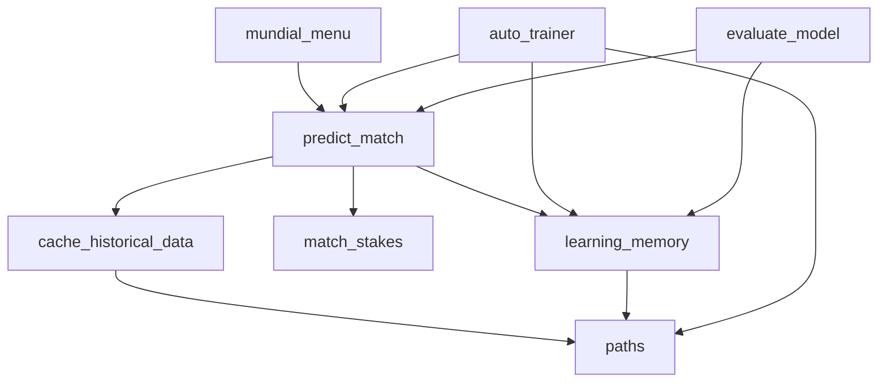

# `mundial_llm/` — the application code

All the Python code that predicts matches, learns from mistakes and evaluates itself. It is a Python package, so every command is run from the repository root with `python -m`. Every command that runs the model accepts `--model` to use another Ollama model.

## Modules

| Module | What it does | Run it with |
|--------|--------------|-------------|
| [`mundial_menu.py`](mundial_menu.py) | **Main entry point.** Lists the remaining 2026 World Cup fixtures from ESPN and predicts the one you pick. Now that the tournament is over, it says so and suggests the other commands. | `python -m mundial_llm` |
| [`predict_match.py`](predict_match.py) | The prediction pipeline: team-name matching, team stats and form from the xG cache, head-to-head, prompt templates, streaming the answer from Ollama, and `parse_prediction()` for reading the model's percentages. | `python -m mundial_llm.predict_match "Portugal" "France"` |
| [`match_stakes.py`](match_stakes.py) | Fetches live group standings and, before the last group game, enumerates every result combination to label each team *already qualified*, *must win*, *a draw is enough*, and so on. Falls back to standard stakes when it can't simulate. | `python -m mundial_llm.match_stakes --home France --away Senegal` |
| [`cache_historical_data.py`](cache_historical_data.py) | Downloads six tournaments from StatsBomb Open Data in parallel and sums shot xG per team, leaving out penalty shootouts, into the local `data/historical_matches_with_xg.csv`. Saves nothing if any match fails. | `python -m mundial_llm.cache_historical_data` |
| [`auto_trainer.py`](auto_trainer.py) | After matches finish, replays each one blind (neutral stakes, only lessons from earlier matches), and on a miss asks the model for a one-sentence lesson. | `python -m mundial_llm.auto_trainer` |
| [`learning_memory.py`](learning_memory.py) | Saves dated lessons to `data/learning_memory.json` and retrieves the ones relevant to a match, optionally only those from before a given date. | (used by the others) |
| [`evaluate_model.py`](evaluate_model.py) | Backtest: predicts past matches from earlier matches only, with the date hidden, and scores the model against an xG baseline (accuracy and Brier score). | `python -m mundial_llm.evaluate_model --from-date 2024-06-01 --sample 0` |
| [`sports_analyst_cli.py`](sports_analyst_cli.py) | General football-analysis chat with the base model, using LangChain with conversation history. It doesn't load the project's data. | `python -m mundial_llm.sports_analyst_cli` |
| [`paths.py`](paths.py) | Where the data files live (the `data/` folder), so the code works from any working directory. | |

## How the modules connect

`predict_match` is the hub: the menu, the auto-trainer and the backtest all build their prompts with its `build_prompt_vars()`, and the auto-trainer and the backtest read the answer with its `parse_prediction()`, so a replayed or backtested match gets the same prompt as a live one.
